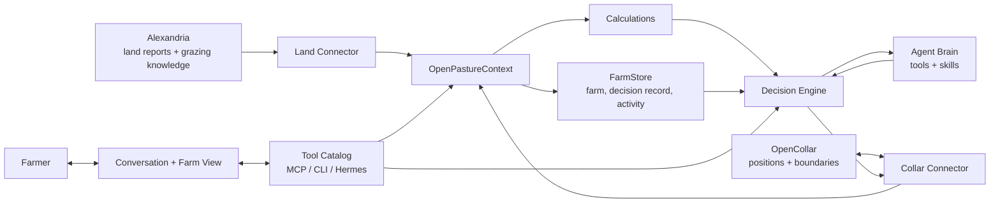

# Architecture

This repository is the engine: the data and decision layer between Alexandria
and OpenCollar, packaged as an agent kit. Connectors adapt it to a runtime.

## The Decision Cycle

Each herd has a decision window, daily by default. For each window the engine
assembles context, derives signals, asks the agent to decide, applies the
farmer's autonomy setting, sends the boundary, records each collar's
acknowledgement, and evaluates the outcome on later cycles. Every step writes
to the decision record. See [Decision Engine](/decision-engine).

## Layers

### Context

`OpenPastureContext` initializes stores, connectors, knowledge retrieval, data
directories, skill directories, active farm state, and scheduling.

### Land Connector

Fetches land reports for a geometry and a set of requested sections, and
stores each section as an observation with provenance. Reports are cached by
geometry, section, and time. Ships with an Alexandria adapter and an offline
fixture provider. See [Land Reports](/land-reports).

### Collar Connector

Reads position fixes, cue events, and collar health. Sends versioned boundary
commands and tracks acknowledgements. Ships with a simulated gateway and an
HTTP gateway adapter. Other virtual-fence vendors can implement the same
interface. See [Collars](/collars).

### Calculations

Pure functions that turn stored data into grazing signals: pressure, rest,
forage, recovery, feed budget, risk, and behavior. They are tools too, so the
agent can call them directly.

### Decision Engine

Owns the cycle: windows, context assembly, invoking the agent, autonomy,
sending boundaries, and evaluating outcomes. A heuristic fallback decides when
no agent brain is available.

### Knowledge

Alexandria is the primary knowledge source. The curated `seed/` corpus and
stored lessons give decisions stable entries to cite. See
[Knowledge](/knowledge).

### Domain

Farms, land units, herds, animals, observations, activity events, grazing
decisions, boundary commands, and knowledge entries, with no runtime coupling.

### Storage

`FarmStore` and `KnowledgeStore` protocols keep storage interchangeable.
SQLite is the default self-hosted backend. Convex is the hosted backend. Raw
collar fixes are kept for a retention window; derived summaries are kept
indefinitely.

### Tool Catalog And Connectors

`src/openpasture/toolkit.py` defines each capability once. The CLI, MCP, and
Hermes connectors consume the same catalog. The farm view in
`openpasture-cloud` reads and writes through it too.

## Design Rules

- If behavior helps any agent operate a farm, keep it in the kit. If it only
  adapts the kit to one runtime, keep it in a connector.
- Every decision is recorded with its inputs, and every input has provenance.
- Nothing reaches a collar without a recorded decision and the farmer's
  autonomy setting allowing it.
- A boundary is not active until the collars confirm it. Unconfirmed
  boundaries are surfaced to the farmer.

Source docs: `docs/architecture.md`, `docs/contracts.md`, and
`docs/cloud-boundary.md`.
