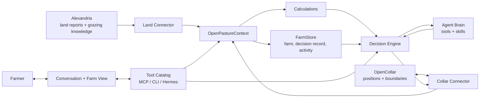

# Architecture

This repository is the Openpasture engine: the data and decision layer between
Alexandria (land and grazing knowledge) and OpenCollar (herd position and
boundary control). The engine is packaged as an agent kit. The ideal runtime is
a coding agent with CLI access, skills, files, and code execution. MCP is a
supported integration method for chat assistants and other MCP-capable clients.

## The Decision Cycle

Each herd has a decision window, daily by default. For each window the engine:

1. **Assembles** a decision context: the herd's collar summary since the last
   decision, a land report for the current paddock and each candidate, the
   farm's grazing history, and knowledge relevant to the conditions.
2. **Derives** grazing signals from that context (see Calculations).
3. **Asks the agent** to decide. The agent can call any tool to look deeper
   before it answers. The answer is a `GrazingDecision`.
4. **Applies the farmer's autonomy setting**: wait for approval, send at a set
   time unless stopped, or send now.
5. **Sends** a `BoundaryCommand` to the herd's collars and records each
   collar's acknowledgement.
6. **Evaluates** the outcome on later cycles and writes it back to the decision.

Every step writes to the decision record, so the full story of a decision can
be replayed: what the engine saw, what it concluded, what the farmer did, what
the collars did, and what the land did.

The formats for land reports, boundary commands, and decisions are defined in
`docs/contracts.md`.

## Kit Layers

### Context

`src/openpasture/context.py` is the runtime-agnostic kit kernel. It initializes
stores, connectors, knowledge retrieval, data directories, skill directories,
active farm state, and scheduling.

### Land Connector

Fetches land reports from Alexandria for a geometry and a set of requested
sections, and stores each report as an observation with full provenance.
Weather and satellite ingestion in `src/openpasture/ingestion/` sit behind this
connector. Reports are cached by geometry, section, and time so repeated
decisions do not refetch unchanged data.

### Knowledge

Grazing knowledge comes from Alexandria's indexes plus the curated `seed/`
corpus. `src/openpasture/knowledge/` handles retrieval, lesson storage, and
citations, so every decision can point to the lessons that shaped it.

### Collar Connector

Speaks the OpenCollar protocol. It reads position fixes, cue events, and collar
health, and it sends boundary commands and tracks acknowledgements. Other
virtual-fence vendors can be supported by implementing the same interface.

### Calculations

Pure functions over stored data. They turn raw inputs into grazing signals:

- grazing pressure: animal-days per acre from collar positions,
- rest: days since each paddock was last grazed,
- forage: standing forage estimates from imagery and farmer observations,
- recovery: how quickly each paddock has regrown after past grazes,
- feed budget: days of grazing ahead given forage, herd demand, and forecast,
- risk: heat, cold, drought, flood, and access risk from weather and hazards,
- behavior: time grazing versus resting, and pressure on the boundary.

Calculations are tools too, so the agent can call them directly.

### Decision Engine

Owns the decision cycle: scheduling windows, assembling context, invoking the
agent, applying autonomy settings, sending boundaries, and evaluating outcomes.
`src/openpasture/briefing/` holds the current assembler and default heuristic
advisor. The heuristic advisor remains as a fallback when no agent brain is
available.

### Domain

`src/openpasture/domain/` defines farm primitives: farms, land units, herds,
animals, observations, activity events, grazing decisions, boundary commands,
and knowledge entries. These objects remain framework-agnostic.

### Storage

`FarmStore` and `KnowledgeStore` protocols keep storage interchangeable.

- SQLite is the default self-hosted backend.
- Convex is the hosted/cloud backend.
- Future backends implement the protocols rather than changing tool behavior.

Collar fixes are high-volume. Stores keep raw fixes for a retention window and
keep derived summaries per herd and per land unit indefinitely.

### Tool Catalog And Connectors

`src/openpasture/toolkit.py` defines each executable capability once. A
`ToolSpec` includes the name, JSON schema, handler, description, tags, and
related skills. The MCP connector, CLI, and Hermes connector all consume this
catalog. The farm view in `openpasture-cloud` reads and writes through the same
catalog.

### Skills

`skills/` contains portable markdown runbooks, including how to reason about a
move decision. Skills are not tied to one runtime.

## Design Rules

- If behavior helps any agent operate a farm, keep it in the kit. If behavior
  only adapts the kit to one runtime, keep it in a connector.
- Every decision is recorded with its inputs, and every input has provenance.
- Nothing reaches a collar without a recorded decision and the farmer's
  autonomy setting allowing it.
- A boundary is not active until the collars confirm it. Unconfirmed
  boundaries are surfaced to the farmer.
