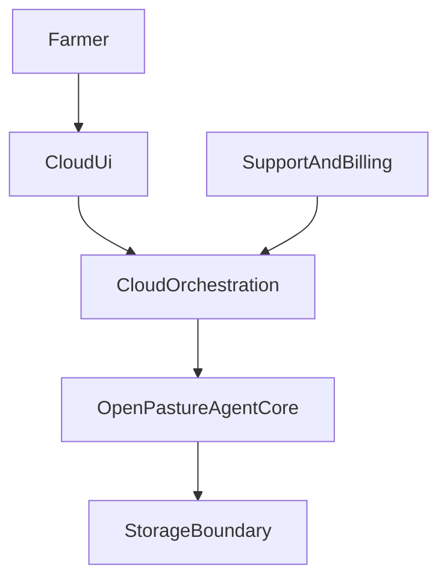

# Cloud Boundary

`Openpasture` is the open-source engine: the data and decision layer between
Alexandria and the collars.

The hosted Openpasture product is a separate, monetized layer that wraps this
engine with managed infrastructure and a proprietary product surface.

## Core Rule

The engine is the product. The decision record is the core asset, and it lives
here.

This repository owns the logic that a self-hosting farmer should be able to run
without the hosted platform:

- farm onboarding primitives
- farm structure: land units, herds, animals, and collar links
- observation recording
- the decision cycle and the decision record
- grazing signal calculations
- autonomy settings and how they gate boundary commands
- the land connector (Alexandria) and the collar connector (OpenCollar)
- the morning brief as a readable wrapper of the latest decision
- knowledge retrieval and ingestion
- self-hosted scheduling behavior
- self-hosted validation and runtime packaging

The separate cloud repository should own the managed wrapper:

- account management
- authentication and authorization
- billing and subscriptions
- hosted environment provisioning
- messaging transport orchestration
- backups and recovery
- the farm view: the herd map, today's and the proposed boundary, the decision
  timeline, paddock history, and analytics
- notifications and approvals: telling the farmer a decision is waiting and
  collecting approve, modify, or reject from web or mobile
- premium UI and mobile/web product surfaces
- support and admin tooling
- hosted analytics and operations

## Architecture Direction

## The Farm View Reads Through The Kit

The farm view does not keep its own copy of decisions or reason about grazing.

- It reads decisions with `list_decisions` and `get_decision`, boundary state
  with `get_boundary_status`, and positions with `get_herd_positions`.
- Approvals, edits on the map, and overrides go back through
  `respond_to_decision`. The kit records the response and, when the farmer's
  autonomy setting allows, sends the boundary.
- Autonomy changes go through `set_autonomy`.
- Notifications are triggered by decision status on the record, for example a
  decision waiting in `proposed`, or collars that did not confirm a boundary.

A self-hosted farmer gets the same record and the same actions through
conversation or the CLI. The cloud adds the map and the delivery, not the
decision.

## Guardrails

- Do not move core grazing reasoning into the cloud UI or cloud-only services.
- Do not let the cloud send boundary commands around the kit. Every command
  comes from a recorded decision.
- Do not make the OSS agent unusable in order to drive hosted adoption.
- Do not add hosted-only concepts to this repo unless self-hosted farmers need
  the same behavior.
- Prefer wrapping existing agent tools and workflows over reimplementing them in
  the cloud product.

## Storage Boundary

This repo defaults to SQLite and keeps storage behind protocol interfaces.

That means the cloud layer can introduce hosted storage and orchestration later,
but the farm reasoning loop should continue to work against the same logical
contracts.

## Practical Meaning

If a feature is required for a self-hosted farmer to run the agent, it belongs
here.

If a feature is primarily about hosting, monetization, managed UX, or internal
operations, it belongs in the cloud repo.
