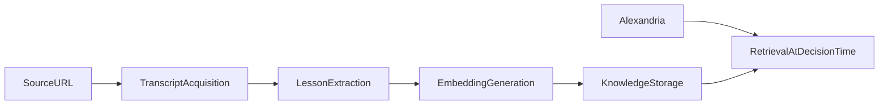

# Knowledge Base

The knowledge base is the agent's durable ancestral memory.

## Purpose

`Openpasture` should not rely only on generic model priors. It should reason with curated lessons from trusted practitioners and connect those lessons to the daily condition of a specific farm.

## Where Knowledge Comes From

Two sources, used together:

- **Alexandria** is the primary source. It carries research papers,
  practitioner videos, and hands-on grazing wisdom from graziers like Greg
  Judy, already indexed. Openpasture queries it for the situation at hand
  instead of copying it wholesale.
- **The curated local corpus** in `knowledge.db`, starting from `seed/`. It
  holds lessons Openpasture has distilled into `KnowledgeEntry` records with
  stable ids and attribution, plus sources the farmer adds.

The curated corpus still matters. A decision cites the lessons that shaped it
by `knowledge_entry_id`, and those ids need to stay stable and readable years
later. The seed also keeps decisions grounded when Alexandria is unreachable
or not configured.

Local ingestion is for what Alexandria does not carry: the farmer's own notes,
local extension material, and trusted sources not yet indexed. Search before
ingesting so the local corpus does not duplicate Alexandria.

## Source Types

Local ingestion focuses on YouTube transcripts and written sources from trusted
rotational and regenerative grazing practitioners.

Examples of source categories:

- rotational grazing instruction,
- daily movement practices,
- animal behavior signals,
- multi-species sequencing,
- pasture observation heuristics,
- technology-assisted pasture systems.

## Extraction Model

Every source should be distilled into one or more `KnowledgeEntry` objects.

The initial types are:

- `principle`: a durable rule of thumb,
- `technique`: a repeatable management move,
- `signal`: something observable that changes interpretation,
- `mistake`: a known anti-pattern or warning sign.

## Pipeline

## Retrieval During Decisions

When the agent works through a grazing decision, it should retrieve the most relevant lessons for the current conditions, such as residual before heavy rain or rest in a summer slump, rather than loading the entire corpus blindly.

Lessons that actually shaped the call are recorded in the decision's `inputs.knowledge_entry_ids`. The result should ground decisions in explicit lessons and make the reasoning legible.

## Seed Knowledge

The repository includes starter knowledge based on cross-cutting principles and named practitioners. This seed exists to make the first local test useful before a farmer adds their own sources.

## Batch Operations

Author-scale ingestion should use batch manifests and queue-driven processing rather than one-off scripts. The reusable runner now supports:

- creating an ingestion batch from discovered sources,
- claiming one source at a time for agent processing,
- recording source-level results,
- inspecting batch totals and failures.

## Productization

For the product path of the shared ancestral corpus, see `docs/knowledge-productization.md`.
